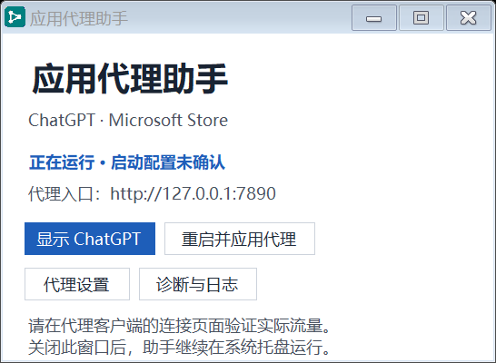
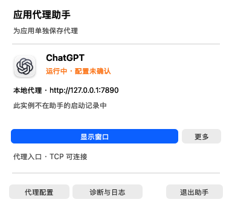

# ChatGPT App Proxy (Windows / macOS)

[简体中文](README.zh-CN.md)

Native tray and menu bar assistants that launch the installed official ChatGPT desktop app with an existing HTTP/Mixed proxy. Configure the assistant once, then use its icon to launch, show, or request a normal restart of ChatGPT.

## Download

Open [GitHub Releases](https://github.com/bxzymy/chatgpt-app-proxy/releases) and choose the package for your platform. If no published release is available, use the source-build commands below.

| Platform | Release package | Daily entry point | Guide |
| --- | --- | --- | --- |
| Windows | `AppProxy-<version>-Windows.zip` | Native tray assistant `App Proxy.exe` | [Windows guide](docs/windows.md) |
| macOS | `AppProxy-<version>-macOS-universal.zip` | Native menu bar assistant `App Proxy.app` | [macOS guide](docs/macos.md) |

Each package includes the application, English and Chinese instructions, the MIT license, and source/version metadata. `SHA256SUMS.txt` accompanies the two ZIPs. Download a platform ZIP from release assets; GitHub's automatic **Source code** archives contain source rather than a built app.

Windows builds are unsigned. macOS builds use ad-hoc signing without Apple notarization; the package instructions cover first-open handling. See [v1.0.0 release notes](docs/releases/v1.0.0.md) and the [release preparation guide](docs/RELEASING.md).

## Quick start

1. Install the official ChatGPT desktop app and start your existing proxy client, such as Clash Verge Rev / Mihomo.
2. Confirm its **HTTP or Mixed** listener. System proxy and TUN can stay disabled.
3. Extract the release ZIP. Put the EXE in a stable folder on Windows, or move the `.app` into Applications on macOS.
4. Open the assistant and save the actual proxy setting. Windows uses the loopback port, default `127.0.0.1:7890`; macOS accepts an HTTP/Mixed address and the selected ChatGPT.app path.
5. Completely quit ChatGPT before applying the proxy for the first time, then launch it through the assistant. Verify real requests and rule matches in your proxy client's **Connections** view.

Closing the panel leaves the assistant in its tray/menu bar. Quitting the assistant leaves ChatGPT running. Login startup and automatic ChatGPT launch are separate options, both off by default. Restart checks the proxy before requesting a normal close/quit. If Windows ChatGPT keeps running after its window closes, quit it from its own menu and launch again.

## Requirements

| Platform | Assistant requirements |
| --- | --- |
| Windows | Windows 10 1903+ / Windows 11, .NET Framework 4.8+ and Windows PowerShell 5.1 (included), installed Microsoft Store ChatGPT. |
| macOS | macOS 13+ for the assistant, a compatible installed official ChatGPT.app. The assistant bundle includes Apple Silicon and Intel executable slices; ChatGPT's own hardware/OS requirements still apply. |

Daily use does not require an installer, administrator access, a .NET SDK, Xcode, Node.js, or Python. The interface currently uses Chinese labels. Both platforms require a working unauthenticated HTTP/Mixed proxy; this project does not provide proxy servers.

## Interface previews

| Windows tray panel | macOS menu bar panel |
| --- | --- |
|  |  |

These previews render the actual native controls offscreen using isolated example data. They are not desktop screenshots or evidence of real proxy routing. Settings and diagnostics previews are in the platform guides.

## Build from source

Windows, from the repository root:

```powershell
powershell.exe -NoProfile -ExecutionPolicy Bypass -File .\windows\build.ps1
```

Open `dist/App Proxy.exe`. The build uses the Windows built-in C# compiler; the PowerShell launch script is embedded, so the EXE can be copied on its own.

macOS, from the repository root:

```bash
bash macos/build.sh
```

Open `dist/App Proxy.app`. The build uses macOS built-in `osacompile`, AppKit/JXA, and ad-hoc signing. Native sources live in [`windows/`](windows/) and [`macos/`](macos/); both read the root [`VERSION`](VERSION).

## Original Windows script entry point

The original [`Launch-ChatGPT.cmd`](Launch-ChatGPT.cmd) / [`Launch-ChatGPT.ps1`](Launch-ChatGPT.ps1) remains available. Completely quit ChatGPT, then double-click the `.cmd`, or specify a port:

```powershell
powershell.exe -NoProfile -ExecutionPolicy Bypass -File .\Launch-ChatGPT.ps1 -Port 7897
```

The script's optional `-ForceRestart` forcibly closes existing processes and can discard unsaved work. The native assistant's ordinary restart does not use this option.

## Proxy behavior and troubleshooting

```text
ChatGPT startup arguments / process-scoped proxy environment
    -> existing HTTP/Mixed listener
    -> Clash / Mihomo rules
    -> PROXY or DIRECT
```

Rules apply to traffic that actually enters the proxy. Startup parameters and environment variables cannot enforce routing for native components that ignore them. A reachable port or matching process record does not establish that all app traffic uses the proxy. Verify login, chat, uploads, voice, and other features separately.

- **Port unavailable:** start the proxy client and check its actual HTTP/Mixed port.
- **App not found:** install the official app; this project does not install ChatGPT.
- **Configuration changed:** restart ChatGPT through the assistant to attempt applying it.
- **App starts but does not connect:** inspect the proxy client's connection view. Windows MSIX activation can change between app releases; the package-context fallback is version dependent.

See [Clash rule examples](docs/clash-rules.md) and the [Windows](docs/windows.md) / [macOS](docs/macos.md) guides for details.

## Development checks

```powershell
# On Windows: build plus isolated fixture/native-control tests
powershell.exe -NoProfile -ExecutionPolicy Bypass -File .\windows\tests\Run-Tests.ps1
```

```bash
# Model tests also run outside macOS; full native tests require macOS
node --test macos/tests/core.test.js
node --test macos/tests/*.test.js
```

GitHub Actions prepares both release ZIPs on their native systems. See [release preparation](docs/RELEASING.md). Tests use isolated fixture apps and loopback listeners; they do not close/restart real ChatGPT or register login startup.

## Security and privacy

The assistants do not modify the system proxy, enable TUN, install drivers, inject DLLs, modify ChatGPT, or collect telemetry. Windows proxy variables apply only to the helper and its children; `ExecutionPolicy Bypass` applies only to the child PowerShell process. Login startup is registered only when explicitly selected in settings.

Settings and rotating logs remain local: `%LOCALAPPDATA%\AppProxyAssistant\` on Windows and `~/Library/Application Support/AppProxyAssistant/` on macOS. Never publish proxy subscriptions, node credentials, account tokens, or private logs.

## License

[MIT](LICENSE).
