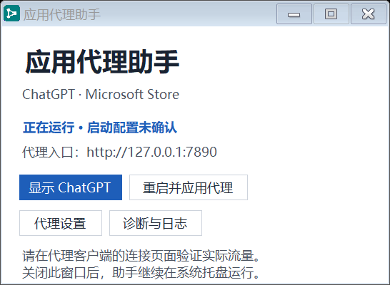
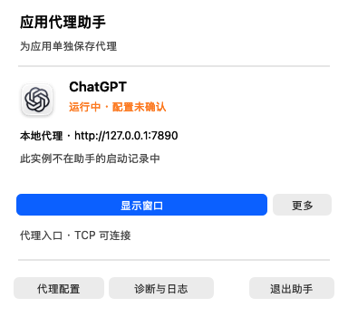

# ChatGPT 应用级代理启动器（Windows / macOS）

[English](README.md)

Windows 原生托盘助手和 macOS 原生菜单栏助手，为已安装的官方 ChatGPT 桌面应用保存代理设置，并提供启动、显示与正常重启操作。配置一次后，通过托盘／菜单栏图标使用。

## 下载

打开 [GitHub Releases](https://github.com/bxzymy/chatgpt-app-proxy/releases)，选择与你的平台对应的发布包。如果尚无已公开版本，可使用下方的源码构建方法。

| 平台 | 发布包 | 日常启动入口 | 指南 |
| --- | --- | --- | --- |
| Windows | `AppProxy-<版本>-Windows.zip` | 原生托盘助手 `App Proxy.exe` | [Windows 指南](docs/windows.zh-CN.md) |
| macOS | `AppProxy-<版本>-macOS-universal.zip` | 原生菜单栏助手 `App Proxy.app` | [macOS 指南](docs/macos.zh-CN.md) |

每个包包含程序、中英文说明、MIT 许可证和版本／源码提交信息。两个 ZIP 的校验值见同一 Release 的 `SHA256SUMS.txt`。请下载发布附件中的平台 ZIP；GitHub 自动附带的 **Source code** 是源码归档，不包含构建好的程序。

Windows EXE 未签名；macOS 应用采用 ad-hoc 签名，未进行 Apple 公证。首次打开的处理方法见包内说明。另见 [v1.0.0 发布说明](docs/releases/v1.0.0.md) 与 [发布准备流程](docs/RELEASING.md)。

## 第一次使用

1. 安装官方 ChatGPT 桌面应用，启动已有的 Clash Verge Rev / Mihomo 等代理客户端。
2. 确认 **HTTP 或 Mixed** 监听入口正常。系统代理和 TUN 可以保持关闭。
3. 解压发布包。Windows 把 EXE 放在固定目录；macOS 把 `.app` 放进「应用程序」。
4. 打开助手，保存实际代理配置。Windows 填写本地端口，默认 `127.0.0.1:7890`；macOS 填写 HTTP / Mixed 地址并选择 ChatGPT.app。
5. 首次应用代理前，请从 ChatGPT 自身菜单完全退出，再通过助手启动。在代理客户端的「连接」页面验证真实请求和规则命中。

关闭面板后，助手继续在托盘／菜单栏驻留；退出助手后 ChatGPT 保持运行。登录自启动和助手启动时自动启动 ChatGPT 是独立选项，默认均关闭。重启会先检查代理，再请求正常关闭或退出。如果 Windows ChatGPT 关闭窗口后仍驻留后台，请从其自身菜单完全退出后再启动。

## 运行要求

| 平台 | 助手要求 |
| --- | --- |
| Windows | Windows 10 1903+ / Windows 11，系统自带的 .NET Framework 4.8+ 与 Windows PowerShell 5.1，以及已安装的 Microsoft Store 版 ChatGPT。 |
| macOS | 助手要求 macOS 13+，并已安装与系统兼容的官方 ChatGPT.app。助手本身包含 Apple Silicon 与 Intel 架构；目标 ChatGPT 仍需满足其自身的硬件与系统要求。 |

日常无需安装器、管理员权限、.NET SDK、Xcode、Node.js 或 Python。界面目前为中文。两端都需要已有的无认证 HTTP / Mixed 代理，本项目不提供代理服务器。

## 界面预览

| Windows 托盘面板 | macOS 菜单栏面板 |
| --- | --- |
|  |  |

图片使用隔离示例数据对实际原生控件离屏渲染，属于界面预览，不是桌面截图，也不证明真实代理流量。设置与诊断窗口见各平台指南。

## 从源码构建

Windows 在仓库根目录执行：

```powershell
powershell.exe -NoProfile -ExecutionPolicy Bypass -File .\windows\build.ps1
```

生成 `dist/App Proxy.exe`。构建使用系统内置 C# 编译器；PowerShell 启动脚本已嵌入，日常可单独复制这一个 EXE。

macOS 在仓库根目录执行：

```bash
bash macos/build.sh
```

生成 `dist/App Proxy.app`。构建使用 macOS 自带的 `osacompile`、AppKit/JXA 和 ad-hoc 签名。源码分别位于 [`windows/`](windows/) 和 [`macos/`](macos/)，版本统一读取根目录 [`VERSION`](VERSION)。

## 原有 Windows 脚本入口

仍可使用 [`Launch-ChatGPT.cmd`](Launch-ChatGPT.cmd) / [`Launch-ChatGPT.ps1`](Launch-ChatGPT.ps1)。完全退出 ChatGPT 后双击 `.cmd`，或在命令行指定端口：

```powershell
powershell.exe -NoProfile -ExecutionPolicy Bypass -File .\Launch-ChatGPT.ps1 -Port 7897
```

脚本的可选参数 `-ForceRestart` 会强制关闭已有进程，可能丢失未保存的工作。原生助手的普通重启不使用此参数。

## 代理原理与排查

```text
ChatGPT 启动参数 / 进程级代理环境变量
    -> 已有 HTTP / Mixed 监听入口
    -> Clash / Mihomo 规则匹配
    -> PROXY 或 DIRECT
```

规则处理已经进入代理的流量。启动参数与环境变量无法强制不支持这些设置的原生组件走代理。端口可连接、启动记录与进程匹配，都不等于全部流量已走代理；登录、聊天、上传、语音等功能应分别验证。

- **端口不可用**：启动代理客户端，并核对实际 HTTP / Mixed 端口。
- **找不到应用**：先安装官方应用，本项目不安装 ChatGPT。
- **配置已更改**：从助手请求重启，以尝试应用新配置。
- **应用能启动但无法联网**：检查代理客户端的连接页面。Windows MSIX 更新可能改变激活方式，包上下文启动回退取决于具体版本。

详见 [Clash 规则示例](docs/clash-rules.md)、[Windows 指南](docs/windows.zh-CN.md) 与 [macOS 指南](docs/macos.zh-CN.md)。

## 开发验证

```powershell
# Windows：构建与隔离模拟应用／原生控件测试
powershell.exe -NoProfile -ExecutionPolicy Bypass -File .\windows\tests\Run-Tests.ps1
```

```bash
# 模型测试可跨平台执行；完整原生测试需要 macOS
node --test macos/tests/core.test.js
node --test macos/tests/*.test.js
```

GitHub Actions 在两端原生系统上准备发布包，操作见 [发布准备流程](docs/RELEASING.md)。测试只使用隔离模拟应用和回环监听，不关闭或重启真实 ChatGPT，也不注册登录自启动。

## 安全与隐私

助手不修改系统代理、开启 TUN、安装驱动、注入 DLL、修改 ChatGPT 或收集遥测。Windows 代理变量只作用于后台助手进程及其子进程，`ExecutionPolicy Bypass` 仅影响 PowerShell 子进程。登录自启动仅在设置中明确勾选并保存后注册。

设置与轮转日志保存在本机：Windows 为 `%LOCALAPPDATA%\AppProxyAssistant\`，macOS 为 `~/Library/Application Support/AppProxyAssistant/`。不要公开代理订阅、节点凭据、账户令牌或私人日志。

## 许可证

[MIT](LICENSE)。
