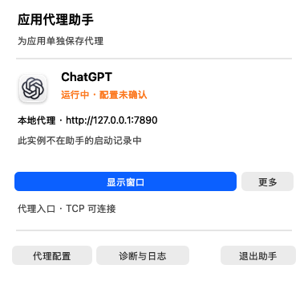
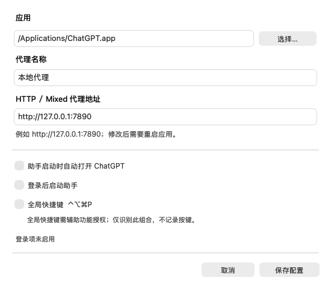
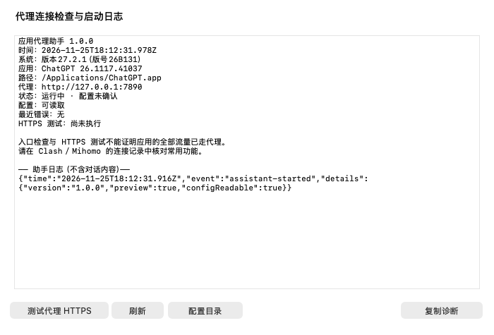

# Native macOS menu bar assistant

[简体中文](macos.zh-CN.md) · [Project home](../README.md)

`App Proxy.app` saves a proxy configuration for the installed official ChatGPT.app and provides native menu bar controls to launch, show, or gracefully restart it. It uses an existing HTTP/Mixed proxy listener. It does not change the system proxy, enable TUN, or modify ChatGPT.app.

Version 1 supports ChatGPT. Applications and proxy endpoints are modeled separately for future independent Claude and other app configurations; each additional app requires its own adapter and verification.

## Build and start

Requirements: macOS 13 or later, the official ChatGPT.app, and an existing HTTP/Mixed proxy listener such as `http://127.0.0.1:7890`.

From the repository root:

```bash
bash macos/build.sh
```

Double-click `dist/App Proxy.app`, then use its network icon in the menu bar. The built app includes Apple Silicon and Intel architectures. Building and running use macOS built-in tools; Xcode, Node.js, and Python are not required. Node.js is needed only for development tests.

Local builds are ad-hoc signed, not Apple-notarized. Move the app to a stable location before enabling launch at login.

## Configure and launch ChatGPT

1. Start your existing proxy client. Leave system proxy and TUN disabled.
2. Open the assistant's proxy settings and select ChatGPT.app.
3. Enter the actual HTTP/Mixed address and save.
4. Click the launch button. If ChatGPT is already running, the primary button shows its window; use More → Restart and apply proxy to apply the saved configuration.

Restart checks the proxy first, then requests a normal quit. It never force-kills the app. Changing the endpoint requires a restart. Quitting ChatGPT does not trigger automatic relaunch; quitting the assistant leaves ChatGPT running.

## Interface previews

These images render the version's real AppKit controls offscreen with isolated example data. They are interface previews, not desktop captures, and the displayed state is not evidence of your app's proxy routing.



The panel distinguishes stopped, launched with the saved configuration, running with unconfirmed configuration, and configuration changes requiring a restart. A saved process record includes the PID, launch time, application path, and configuration identity to avoid mistaking a reused PID for an earlier launch.



Version 1 supports unauthenticated HTTP/Mixed endpoints, not SOCKS-only listeners or proxy-node switching. Login startup, automatic ChatGPT launch when the assistant starts, and the `⌃⌥⌘P` global shortcut are separate optional settings, all disabled by default. The shortcut requires Accessibility access and only recognizes that combination; it does not record keystrokes.



A TCP check only verifies that a port accepts connections. The manual HTTPS test sends an unauthenticated HEAD request to `https://chatgpt.com` through the selected proxy to check CONNECT/TLS. A website response such as 403 can be an access policy response, not a failed proxy connection.

Verify real chat, upload, voice, and other traffic in the proxy client's connection view. Startup flags and environment variables cannot enforce routing for components that ignore them.

## Data and development

Settings, backups, process records, and rotating assistant logs live in `~/Library/Application Support/AppProxyAssistant/`. The assistant does not store conversation content or complete ChatGPT console output. Each log rotates at 1 MiB, retaining two older files. Unreadable or unsupported configurations are preserved rather than silently overwritten.

Source and tests live in [`macos/`](../macos/). See the [developer guide](../macos/README.zh-CN.md).

```bash
node --test macos/tests/core.test.js
# On macOS with loopback networking and WindowServer access:
node --test macos/tests/*.test.js
```

Integration tests use only temporary fixture apps and loopback proxy listeners. They do not control real ChatGPT, register login startup, or enable the global shortcut. The root Windows launchers retain their existing behavior.
