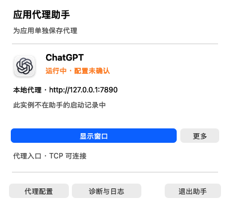
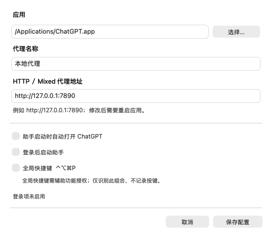
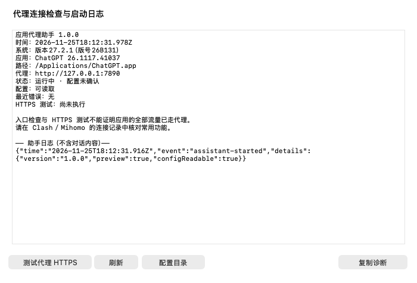

# macOS 原生菜单栏助手

[English](macos.md) · [项目首页](../README.zh-CN.md)

`App Proxy.app` 为已安装的官方 ChatGPT.app 保存代理配置，并从原生菜单栏面板启动、显示窗口或正常重启应用。它使用你已有的 HTTP／Mixed 代理入口，不提供代理服务器，不修改系统代理、不启用 TUN，也不修改 ChatGPT.app 的安装文件。

第一版正式支持 ChatGPT。应用与代理入口分别保存，已为 Claude 等应用的独立配置预留结构；其他应用需要单独适配和验证。

## 准备与构建

- macOS 13 或更新版本；构建的应用包含 Apple Silicon 与 Intel 两种架构。
- 已安装官方 ChatGPT.app。
- 已运行的本地 HTTP／Mixed 代理，例如 Clash／Mihomo 的 `http://127.0.0.1:7890`。请填写代理客户端实际监听的端口。

在项目根目录执行：

```bash
bash macos/build.sh
```

生成的应用位于 `dist/App Proxy.app`。双击它，菜单栏会出现网络图标；助手不占用 Dock 图标。构建和运行仅依赖 macOS 自带工具，不需要 Xcode、Node.js 或 Python。开发测试才需要 Node.js。

你可以先把应用移到长期保留的位置，再开启登录启动。项目本地构建采用 ad-hoc 签名，尚未进行 Apple 公证；公开分发需另行完成签名与公证。

## 第一次使用

1. 在已有代理客户端中确认 HTTP／Mixed 入口可用，系统代理与 TUN 保持关闭。
2. 点击菜单栏网络图标，打开“代理配置”。
3. 确认 ChatGPT.app 路径和完整代理地址，例如 `http://127.0.0.1:7890`，保存配置。
4. ChatGPT 尚未运行时，点击“带代理启动”。
5. 如果 ChatGPT 已通过 Dock 或旧脚本启动，可先点击“显示窗口”继续使用；需要应用所选代理时，再从“更多”选择“重启并应用代理”。

重启前会先检查代理入口，再请求 ChatGPT 正常退出。应用拒绝退出或等待超时，助手不会强制杀死它；请先处理应用内的保存或退出提示。修改代理地址后，需要重启目标应用才能应用新配置。

## 菜单栏面板

以下三张图片由本版本的原生 AppKit 控件在隔离示例配置下离屏渲染，展示实际控件布局，属于界面预览，并非桌面截屏；显示的状态不代表你的运行环境。



主按钮会根据状态显示“带代理启动”或“显示窗口”。“更多”提供正常重启、正常退出、诊断及配置目录入口。关闭 ChatGPT 窗口但进程仍在时，可以通过助手重新显示窗口；主动退出 ChatGPT 后不会自动拉起。退出助手也不会退出 ChatGPT。

| 状态 | 含义 |
| --- | --- |
| 未运行 | 当前没有检测到所选路径的应用实例。 |
| 运行中 · 已按配置启动 | 助手保存的 PID、进程启动时间、路径及配置标识相符，启动时已核对新进程的代理参数。 |
| 运行中 · 配置未确认 | 实例不在助手的启动记录中；显示窗口不会改变其现有代理配置。 |
| 运行中 · 等待重启 | 代理配置、应用路径或版本发生了变化，需要重启后应用。 |
| 找不到应用 | 在“代理配置”中重新选择已安装的 ChatGPT.app。 |

“已按配置启动”不等于所有流量都经过了代理。助手通过启动参数和进程环境配置应用，不能强制拦截忽略这些设置的网络组件。

## 代理与偏好设置



- **代理地址**：填写完整的 `http://主机:端口`。首版支持无认证的 HTTP／Mixed 入口，不支持 SOCKS-only 端口、认证代理或节点切换。
- **助手启动时自动打开 ChatGPT**：默认关闭；与助手的登录启动是独立选项，不会重启已经运行的 ChatGPT。
- **登录后启动助手**：默认关闭，使用 macOS Service Management。系统可能需要你在“通用 → 登录项与扩展”中允许。移动应用位置后需要重新设置。
- **全局快捷键 `⌃⌥⌘P`**：默认关闭，启用时需要辅助功能权限。只识别这个组合，不记录按键内容；没有授权也能正常使用菜单栏。

若多个应用未来共用同一代理配置，编辑时会为当前应用创建独立副本，避免连带修改其他应用。两个应用若要使用不同出口，代理客户端也需要提供对应入口或路由规则。

## 诊断、日志与流量验证



- **TCP 可连接**：只表示指定端口接受连接，不能证明服务协议正确，也不能证明 ChatGPT 正在使用它。
- **测试代理 HTTPS**：通过所选代理向 `https://chatgpt.com` 发送不携带账号、Cookie 的 HEAD 请求，检查 CONNECT／TLS 通道。网站返回 403 等状态可能是访问策略，并不等同于代理端口不可用。
- **实际流量**：在 Clash／Mihomo 的连接记录中核对聊天、上传、语音及你使用的其他功能。代理客户端的规则仍决定最终走代理还是直连。
- **复制诊断**：先在窗口中检查内容，再按需复制。助手日志只记录自身操作、检查结果和错误，不保存聊天内容或 ChatGPT 的完整控制台输出。

日志超过 1 MiB 后轮转，保留当前文件与两份旧文件。

## 本地数据与恢复

助手数据位于 `~/Library/Application Support/AppProxyAssistant/`，可从“更多”或诊断窗口打开：

| 文件 | 内容 |
| --- | --- |
| `configuration.json` | 版本化的应用列表、代理入口列表和偏好设置。 |
| `configuration.json.backup` | 上次保存前的配置备份。 |
| `launch-records.json` | PID、启动时间及配置标识，用于助手重开后的状态恢复和防止 PID 复用误判。 |
| `Logs/assistant.log` | 助手自身日志。 |

若配置损坏或来自不兼容版本，助手会保留原文件，阻止启动及覆盖。可以在退出助手后检查原文件或从备份恢复，再重新打开。

## 开发与测试

源码、构建和测试集中在 [`macos/`](../macos/)，详见[开发说明](../macos/README.zh-CN.md)。Windows 继续使用根目录的 `Launch-ChatGPT.cmd` 和 `Launch-ChatGPT.ps1`，macOS 构建与测试不依赖它们。

```bash
node --test macos/tests/core.test.js
```

在允许本机回环监听和窗口服务的 macOS 开发环境中，可运行完整测试：

```bash
node --test macos/tests/*.test.js
```

完整测试仅启动临时模拟应用和回环代理，验证 Cocoa 事件、环境变量、正常重启、失败时保留旧实例、日志轮转及打包后的应用入口；不会启动或退出真实 ChatGPT、注册登录项或启用全局快捷键。
