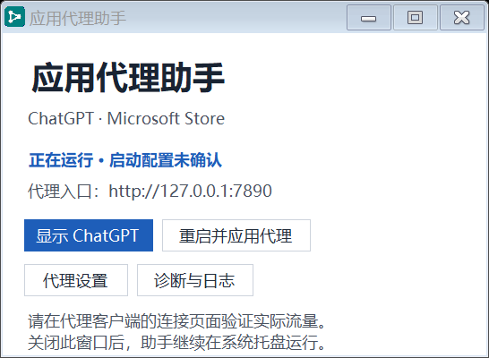
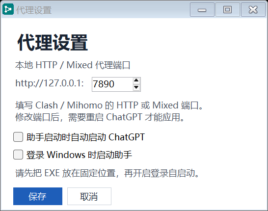
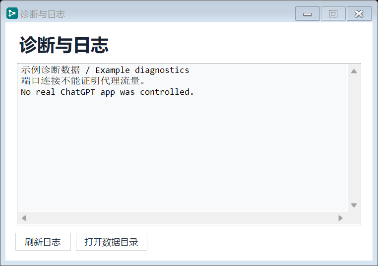

# Native Windows tray assistant

[简体中文](windows.zh-CN.md) · [Project home](../README.md)

`App Proxy.exe` is a small native WinForms tray application with the project's PowerShell launcher embedded inside. Daily use requires only this one EXE. Windows PowerShell runs briefly, without a console window, for package discovery and launching ChatGPT.

## Build and start

Requirements: Windows 10 1903+ / Windows 11, .NET Framework 4.8+ (included), Windows PowerShell 5.1, the Microsoft Store ChatGPT app, and an existing HTTP/Mixed proxy listener.

From the repository root:

```powershell
powershell.exe -NoProfile -ExecutionPolicy Bypass -File .\windows\build.ps1
```

The build uses the Windows built-in C# compiler without downloading dependencies. Visual Studio, the .NET SDK, Node.js, and Python are not required. Copy the resulting `dist/App Proxy.exe` to a stable location. Local builds are unsigned.

Double-click the EXE. Left-click its blue network tray icon to open the panel; right-click for actions. Windows may place the icon in its hidden-icons area. Closing the panel leaves the assistant in the tray. Quitting the assistant leaves ChatGPT running. Opening the assistant again with the same data directory shows the existing instance.

## Configure and launch

1. Start your existing proxy client and verify its HTTP/Mixed listener.
2. Open proxy settings and enter the actual local port, default `7890`.
3. Completely quit ChatGPT before applying the configuration for the first time.
4. Click the launch button. When the app is already running, the button shows its window instead.
5. Verify actual app requests and rule matches in the proxy client's connections view.

Version 1 accepts unauthenticated HTTP/Mixed endpoints at `http://127.0.0.1:<port>`. Saving a new port requires a ChatGPT restart to attempt applying it.



The interface currently uses Chinese labels. These previews render the real WinForms controls offscreen with isolated example data. They are not desktop screenshots or evidence of real proxy routing.

Launch at Windows login and automatic ChatGPT launch when the assistant starts are separate settings, both disabled by default. Automatic launch does not restart existing app processes. Move the EXE to a stable location before enabling login startup. This writes only the current user's `HKCU\Software\Microsoft\Windows\CurrentVersion\Run\AppProxyAssistant` value; unchecking and saving removes it.



## Status and restart

The panel distinguishes stopped, running with unconfirmed launch configuration, launched using the saved port, and a changed configuration requiring restart. A recorded launch must match the PID, process start time, executable path, and saved port. A reused PID alone cannot establish a match. This records a launch attempt with those settings, not proof that all network components honor them.

Restart checks the proxy first, requests a normal window close, and waits up to 12 seconds. A failed proxy check leaves the old app untouched. Some ChatGPT versions keep running after their window closes; the assistant then asks you to quit through ChatGPT's own menu and launch again. It never force-kills the app or continuously relaunches an exited app.

The port check proves only TCP reachability. Verify login, chat, uploads, voice, and other actual traffic separately in your proxy client.

## Diagnostics and local data

Settings, launch records, backups, and rotating assistant logs live in `%LOCALAPPDATA%\AppProxyAssistant\`. The log records only assistant and launcher output, not a continuous ChatGPT console capture, conversations, or traffic. It rotates at approximately 1 MiB and retains two old files; timestamps use UTC. Unreadable or unsupported settings are preserved and automatic launch is suspended. Explicitly saving settings offers to back up the original before recovery.



The assistant does not modify the system proxy, TUN, drivers, ChatGPT files, or system environment variables. MSIX activation can change with app releases; the package-context fallback is not guaranteed across versions.

## Development

See [`windows/README.md`](../windows/README.md) for the source layout. Run the isolated tests:

```powershell
powershell.exe -NoProfile -ExecutionPolicy Bypass -File .\windows\tests\Run-Tests.ps1
```

Tests use only temporary fixture applications and loopback listeners. They do not close/restart real ChatGPT or register login startup. Reports and native control previews are written under `.build/windows/tests-*/`. Real-app proxy routing requires manual verification.
