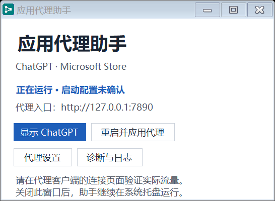
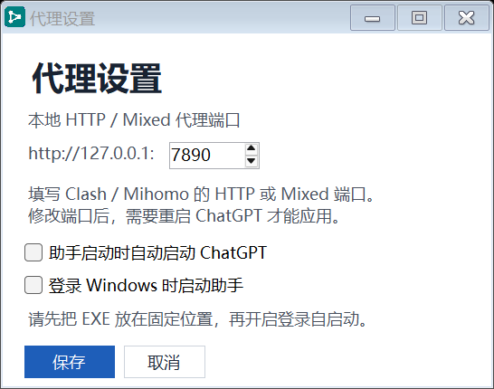
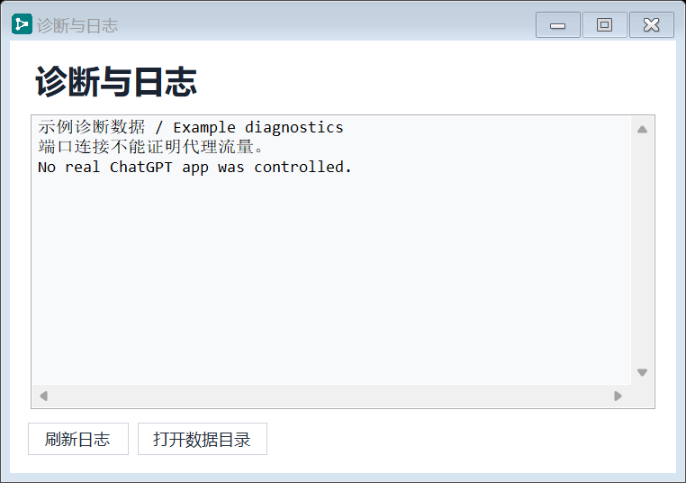

# Windows 原生托盘助手

[English](windows.md) · [项目主页](../README.zh-CN.md)

`App Proxy.exe` 是一个原生 WinForms 托盘应用，内嵌本项目的 PowerShell 启动脚本。日常只需一个 EXE；PowerShell 仅在检测安装包和启动 ChatGPT 时短暂在后台运行，不出现命令行窗口。

## 构建与启动

要求 Windows 10 1903+ / Windows 11、系统自带的 .NET Framework 4.8+、Windows PowerShell 5.1，以及已安装的 Microsoft Store 版 ChatGPT。实际代理由现有 Clash / Mihomo 等客户端提供。

在仓库根目录运行：

```powershell
powershell.exe -NoProfile -ExecutionPolicy Bypass -File .\windows\build.ps1
```

构建使用系统内置的 C# 编译器，不下载依赖，不需要 Visual Studio、.NET SDK、Node.js 或 Python。输出为 `dist/App Proxy.exe`，可以单独复制到固定位置使用。当前构建为未签名的本地应用。

双击 EXE 后打开面板，托盘中出现蓝色网络图标。左键点击图标打开面板，右键打开操作菜单；图标也可能位于 Windows 的隐藏图标区域。关闭面板后助手继续驻留，右键选择「退出助手」才会结束助手。退出助手会保留 ChatGPT 运行。重复打开同一数据目录的助手会唤起已有实例。

## 设置与使用

1. 启动本地代理客户端，确认 HTTP / Mixed 监听正常。
2. 在「代理设置」中填写实际端口，默认 `7890`。
3. 首次应用配置前，请从 ChatGPT 自身菜单完全退出应用。
4. 点击「启动 ChatGPT」。应用已运行时，该按钮改为「显示 ChatGPT」。
5. 在代理客户端的连接页面验证真实请求及规则命中情况。

首版支持 `http://127.0.0.1:<端口>` 的无认证 HTTP / Mixed 入口。保存端口只更新助手配置；正在运行的 ChatGPT 需要重启后才能尝试使用新配置。



这些图片是使用隔离示例数据对实际 WinForms 控件进行离屏渲染的界面预览，不是桌面截图，也不证明真实代理流量。

「登录 Windows 时启动助手」和「助手启动时自动启动 ChatGPT」是两个独立选项，默认均关闭。启用前请把 EXE 放在固定位置。自动启动只在未检测到 ChatGPT 时触发，不会自动关闭已有实例。登录自启动仅写入当前用户的 `HKCU\Software\Microsoft\Windows\CurrentVersion\Run\AppProxyAssistant`，不需要管理员权限；取消勾选并保存可移除该项。



## 状态与重启

| 状态 | 含义 |
| --- | --- |
| ChatGPT 未运行 | 未发现当前解析到的应用路径对应的进程。 |
| 正在运行 · 启动配置未确认 | 检测到进程，但没有匹配的助手启动记录。 |
| 已用当前配置发起启动 · 流量待验证 | 启动记录的 PID、进程启动时间、程序路径与当前进程相符，端口与保存值一致。 |
| 配置已更改 · 重启后应用 | 匹配进程仍在运行，但保存端口与启动记录不同。 |

启动记录反映助手使用了哪些启动参数，不代表应用所有网络组件都接受这些参数。

「重启并应用代理」先检查代理端口，再向应用窗口请求正常关闭，最长等待 12 秒。代理不可用时保留旧实例。若 ChatGPT 关闭窗口后仍驻留后台，或存在待处理对话框，助手会提示从 ChatGPT 自身菜单完全退出，再点击启动。助手不会在此流程中强制结束进程，也不会持续自动拉起已退出的应用。

「检查代理端口」仅验证 TCP 连接。聊天、登录、上传、语音等功能的真实流量仍需在代理客户端中分别验证。

## 诊断与本地数据

设置、启动记录、备份和助手日志默认保存在：

```text
%LOCALAPPDATA%\AppProxyAssistant\
```

日志只记录助手和启动脚本的输出，不持续采集 ChatGPT 控制台、对话内容或流量。日志约 1 MiB 时轮转，保留两份旧日志，时间使用 UTC。无法读取或版本不受支持的设置会保留原文件，自动启动暂停；用户在设置中保存时，可明确选择先备份原文件再恢复设置。



助手不修改系统代理、TUN、驱动、ChatGPT 文件或系统环境变量。应用更新可能改变 MSIX 激活方式；脚本的包上下文启动回退不能保证适用于所有版本。

## 开发与验证

源码说明见 [`windows/README.md`](../windows/README.md)。运行隔离测试：

```powershell
powershell.exe -NoProfile -ExecutionPolicy Bypass -File .\windows\tests\Run-Tests.ps1
```

测试只控制项目构建目录中的模拟应用和本地回环端口，不会关闭或重启真实 ChatGPT，也不注册登录自启动。测试报告与原生控件预览保存在 `.build/windows/tests-*/`。实际应用的网络路由需要手工验证。
